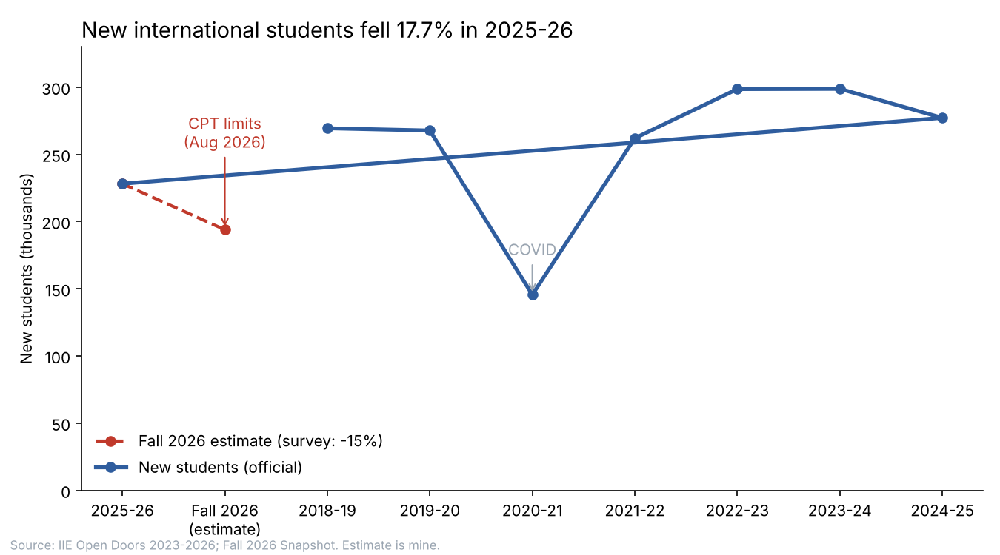
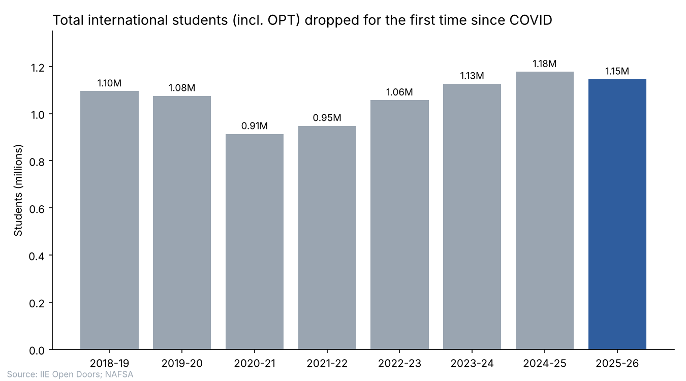
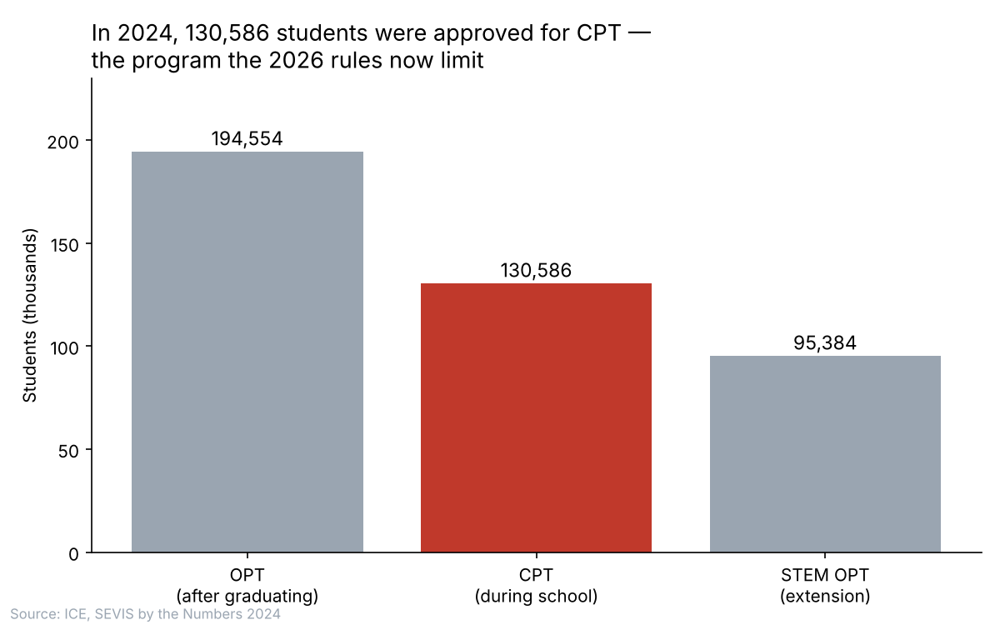

# The CPT Rules and International Students

A data project by Tasnia Ruhi

## The question
In August 2026, the US government told colleges to stop approving **CPT (Curricular Practical Training)**
unless an internship is required for a student's degree. CPT is how international students do internships
while in school. As an international student, this put my own internship plans on hold.

So I asked: **what does the data say about international students and work experience in the US right now?**

## What I found

**1. New international students were already falling before the CPT rules.**
New enrollment dropped **17.7%** in 2025-26 (277,118 → 228,123), and is down **23.6%** from the 2023-24 peak.
A survey of 809 schools suggests another ~15% drop in fall 2026, the first semester after the CPT limits.

**2. The total number of international students fell for the first time since COVID**,
from 1.18 million in 2024-25 to 1.15 million in 2025-26.

**3. CPT is not a small program.** In 2024, **130,586** students were approved for CPT.
These are the students the 2026 rules affect most directly.

## What this data can and can't show
- The drop in new students **started before** the August 2026 CPT rules, so the rules can't be the only cause.
  Visa delays and other policy changes happened in the same period.
- Official CPT numbers for after August 2026 aren't published yet. When the 2026 SEVIS report comes out,
  I can test whether CPT approvals actually fell.
- The fall 2026 number is my estimate from a survey, not an official count.

## How to run it
1. Install Python, then in a terminal run: `pip install pandas matplotlib`
2. In this folder, run: `python analysis.py`
3. The charts appear in the `charts/` folder.

## Files
| File | What it is |
|---|---|
| `analysis.py` | The code. Reads the data, does the math, makes the charts |
| `data/enrollment.csv` | International students per year (IIE Open Doors) |
| `data/work_training.csv` | OPT, CPT and STEM OPT counts (ICE SEVIS by the Numbers) |
| `data/sources.md` | Link for every number |
| `charts/` | The three charts |

## Next steps
- Add CPT numbers once the 2026 SEVIS report is published
- Break it down by state or by field (STEM vs. business)
- Estimate the economic cost (tuition and spending lost)
